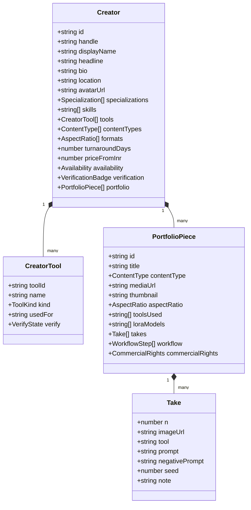
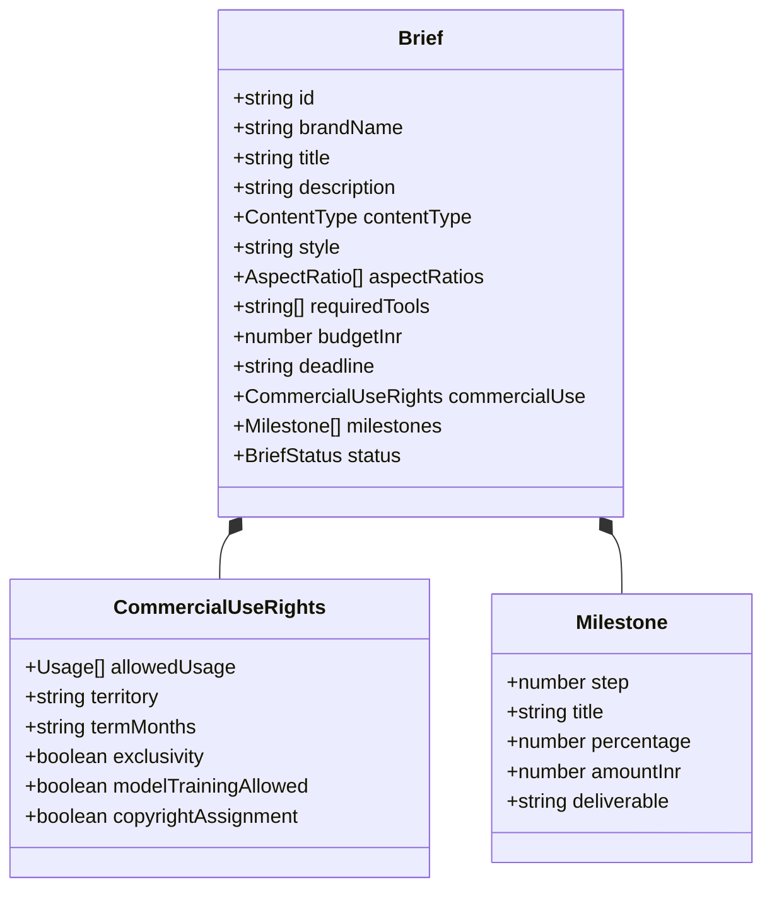

# Retake — Profile & Creative Brief Data Model Specification

> **Deliverable Note for Kampus.VC HacXLerate 2026 Hackathon**  
> *Architecture note covering the creator profile, AI portfolio, and creative brief data models, including verified tools, skills, formats, and commercial-use licensing fields.*

---

## 1. Overview & Philosophy

In generative AI creative production, legacy freelance profiles fail because they treat creative assets as monolithic deliverables without capturing the underlying generative stack, model checkpoints, prompt evolution, or licensing implications.

**Retake (AICCM)** models both Creators and Creative Briefs as **parameterized contracts**, enabling:
1. **Verifiable generative capabilities** (tools, LoRA models, ControlNet pipelines).
2. **Multi-ratio format scoping** (9:16 vertical shorts, 16:9 cinematic masters, 1:1 feeds).
3. **Multi-take iterative transparency** (prompt progression, seed consistency, versioned drafts).
4. **Enforceable commercial-use rights** (licensing tiers, AI training protection, copyright indemnity).

---

## 2. Creator Profile & AI Portfolio Data Model



### 2.1 Creator Profile Fields

| Field | Type | Description / Accepted Values |
| :--- | :--- | :--- |
| `id` | `string` | Unique identifier (e.g. `creator-arjun`) |
| `handle` | `string` | URL-safe slug (e.g. `arjun-patel`) |
| `displayName` | `string` | Human-readable name |
| `headline` | `string` | Core value proposition & generative focus |
| `bio` | `string` | Extended professional summary |
| `location` | `string` | Geographic base (e.g. `Bengaluru, India`) |
| `specializations` | `enum[]` | `ai_film`, `ai_animation`, `product_ads`, `motion_graphics`, `fashion_lookbook`, `music_video`, `social_shorts`, `brand_mascots` |
| `skills` | `string[]` | Specific competencies (e.g. `Prompt Engineering`, `LoRA Training`, `Consistent Character Synthesis`, `Latent Upscaling`, `AnimateDiff`) |
| `tools` | `CreatorTool[]` | Declared tools with verified status badges |
| `contentTypes` | `enum[]` | `video`, `animation`, `still`, `audio`, `mixed` |
| `formats` | `enum[]` | `9:16`, `1:1`, `4:5`, `16:9`, `21:9` |
| `turnaroundDays` | `number` | Minimum delivery turnaround in days |
| `priceFromInr` | `number` | Starting rate in Indian Rupees (INR) |
| `availability` | `enum` | `open` (Ready for briefs), `limited` (Taking select work), `booked` |

### 2.2 Creator Tools & Verification Levels

Each tool entry captures the tool category, usage context, and verification level:

```typescript
export interface CreatorTool {
  toolId: string;
  name: string;
  kind: "video" | "image" | "audio" | "llm" | "editing" | "upscale";
  usedFor: string;
  verify: "unverified" | "self_declared" | "evidence_attached" | "reviewed";
}
```

- **`unverified`**: Creator claimed, no evidence provided.
- **`self_declared`**: Creator declared proficiency with external reference links.
- **`evidence_attached`**: Workflows, JSON pipeline files, or ComfyUI node screenshots uploaded.
- **`reviewed`**: Manually reviewed or platform-audited for production-ready consistency.

### 2.3 Portfolio Pieces & Multi-Take Progression

Every portfolio piece allows clients to "scrub" through the takes that led to the final output:

```typescript
export interface PortfolioPiece {
  id: string;
  title: string;
  contentType: "video" | "animation" | "still" | "audio" | "mixed";
  mediaUrl: string;
  aspectRatio: "9:16" | "1:1" | "4:5" | "16:9" | "21:9";
  toolsUsed: string[];          // e.g., ["ComfyUI", "Runway Gen-3 Alpha", "Topaz Video AI"]
  loraModels?: string[];        // Custom trained LoRAs used for consistency
  takes: Take[];                // Iterative generations leading to final piece
  workflow?: WorkflowStep[];    // Stage-by-stage node or render pipeline
}
```

---

## 3. Brand & Creative Agency Brief Data Model



### 3.1 Brief Definition Fields

| Field | Type | Description |
| :--- | :--- | :--- |
| `id` | `string` | Unique brief ID (e.g. `brief-zomato-midnight`) |
| `brandName` | `string` | Hiring entity (e.g. `Zomato India`) |
| `title` | `string` | Campaign title |
| `description` | `string` | Complete creative and conceptual mandate |
| `contentType` | `enum` | Primary deliverable type (`video`, `animation`, etc.) |
| `style` | `string` | Target aesthetic (e.g. `Cyberpunk neon realism with rainy Mumbai monsoon atmosphere`) |
| `aspectRatios` | `enum[]` | Deliverable aspect ratios: `9:16`, `16:9`, `1:1`, `4:5`, `21:9` |
| `requiredTools` | `string[]` | Mandatory or preferred AI stacks (e.g. `Runway Gen-3`, `ComfyUI`) |
| `budgetInr` | `number` | Total project allocation in Indian Rupees |
| `deadline` | `string` | Target completion date (ISO 8601) |
| `status` | `enum` | `draft`, `published`, `in_review`, `matched`, `in_production`, `completed` |

### 3.2 Commercial-Use & Licensing Matrix

Generative AI projects carry distinct legal and copyright considerations. Retake encodes these directly into every brief:

```typescript
export interface CommercialUseRights {
  // Allowed distribution channels
  allowedUsage: (
    | "organic_social"   // Instagram, X, TikTok unpaid
    | "paid_social"      // Meta Ads, YouTube Shorts paid campaigns
    | "broadcast_ctv"    // Television and OTT streaming ads
    | "out_of_home"      // Digital billboards & theater screens
    | "website"          // Official brand landing pages
    | "internal_only"    // Internal agency pitches & mood reels
  )[];
  
  territory: "India" | "APAC" | "North America" | "Global";
  termMonths: number | "perpetual";
  exclusivity: boolean;             // Creator cannot resell assets or LoRA styles
  modelTrainingAllowed: boolean;    // Brand grants/denies right to use outputs for AI training
  copyrightAssignment: boolean;     // Full transfer of underlying prompts, scripts, and masters
}
```

---

## 4. Algorithmic Match Scoring & Relaxation Model

When a brief is published, Retake computes a composite compatibility score:

$$\text{Score} = w_{\text{tool}} \cdot S_{\text{tool}} + w_{\text{format}} \cdot S_{\text{format}} + w_{\text{budget}} \cdot S_{\text{budget}} + w_{\text{reputation}} \cdot S_{\text{reputation}}$$

- **Tool Alignment ($w_{\text{tool}} = 0.35$)**: Overlap between creator's verified toolchain and the brief's mandatory tools.
- **Format & Content Fit ($w_{\text{format}} = 0.25$)**: Creator's historical portfolio matches for requested aspect ratios and media types.
- **Budget & Turnaround Feasibility ($w_{\text{budget}} = 0.20$)**: Fit between brief budget and creator base rates, plus turnaround capability.
- **Reputation & Verification Tier ($w_{\text{reputation}} = 0.20$)**: Verified badges (`reviewed`, `evidence_attached`), completed briefs count, and client review scores.

### Intelligent Relaxation Handling
If strict filtering yields zero matching creators, the engine suggests parameterized relaxations:
1. *Expand turnaround by +2 days* (surfaces +4 creators).
2. *Widen budget threshold by 10%* (surfaces +3 creators).
3. *Relax specific tool requirement to equivalent diffusion pipeline* (e.g., ComfyUI $\rightarrow$ Stable Diffusion WebUI).

---

## 5. Summary Mapping to Hackathon Deliverables

| Requirement | Implementation in Retake | Schema / Code Reference |
| :--- | :--- | :--- |
| **Tools / Models Used** | `CreatorTool`, `takes[].tool`, `pieces[].toolsUsed` | [schemas.ts](file:///home/ghost/aiccm/frontend/lib/contract/schemas.ts#L39-L46) |
| **Skills & Specialization** | `specializations`, `skills[]` | [schemas.ts](file:///home/ghost/aiccm/frontend/lib/contract/schemas.ts#L9-L19) |
| **Workflows & Multi-Take** | `TakeSchema` (prompts, seeds, iterations), `WorkflowStep` | [schemas.ts](file:///home/ghost/aiccm/frontend/lib/contract/schemas.ts#L48-L68) |
| **Formats & Aspect Ratios** | `AspectRatioSchema` (`9:16`, `1:1`, `4:5`, `16:9`, `21:9`) | [schemas.ts](file:///home/ghost/aiccm/frontend/lib/contract/schemas.ts#L3-L4) |
| **Commercial-Use Rights** | `UsageSchema`, `CommercialUseRights`, `RightsCertificate` | [schemas.ts](file:///home/ghost/aiccm/frontend/lib/contract/schemas.ts#L21-L30) |
| **Creator Verification** | `VerifyStateSchema` (`unverified`, `self_declared`, `evidence_attached`, `reviewed`) | [schemas.ts](file:///home/ghost/aiccm/frontend/lib/contract/schemas.ts#L31-L37) |
| **AI Brief Builder** | `parseBriefDraft` Natural Language NLP Parser | [draft-brief.ts](file:///home/ghost/aiccm/frontend/lib/mocks/draft-brief.ts) |
